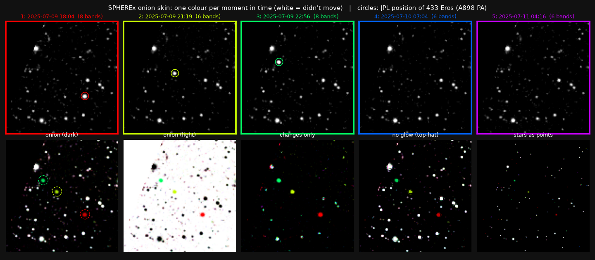
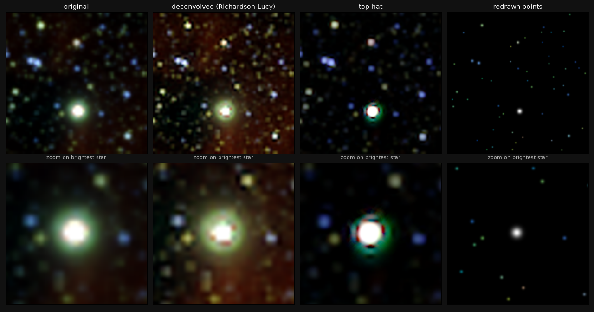

# NASA-Space-App-Challenge-SPHEREx

Python tools that download NASA SPHEREx images from IRSA and turn them into pictures where
**moving objects (asteroids, dwarf planets) are easy to spot**: each moment in time gets its
own colour, so things that stay still look white and things that move leave a coloured trail.


*Asteroid (433) Eros on 9 July 2025: red → yellow → green dots inside the circles where JPL says Eros was. Stars that didn't move are white.*

## Setup

```bash
python -m venv .venv
.venv\Scripts\activate          # Windows  (macOS/Linux: source .venv/bin/activate)
pip install -r requirements.txt
```

## Scripts

| Script | What it does | Main outputs |
| --- | --- | --- |
| `download.py` | Cutouts of one sky spot over time, with wavelength, bad-pixel mask and date per frame | `cutout_*.fits/.png`, `index.csv` |
| `spectral_bands.py` | All 102 SPHEREx colour bands (0.75–5 µm) of one spot, lined up and merged | `composite.png`, `bands_grid.png`, `cube.fits` |
| `deglow.py` | Removes the glow around stars; compares 3 methods | `glow_comparison.png`, `composite_tophat.png`, `composite_points.png` |
| `motion_frames.py` | The "onion skin": N moments in time, each tinted a colour and stacked | `summary.png`, `onion_light.png`, `onion_dark.png`, `changes.png`, `blink.gif` |

```bash
python spectral_bands.py 304.6935 42.4437          # 102 bands of one spot (~15 min first time)
python deglow.py data/bands_304.6935_42.4437        # glow removal on that result
python motion_frames.py 304.6935 42.4437           # onion skin of the same spot
python motion_frames.py 13.2004 14.3800 --start 2025-07-09T17:00 --track 433   # Eros demo
```

Every script prints its options with `--help`. Downloads are cached, so re-running is fast.

## How the onion skin works

1. Find every SPHEREx image of the spot and group them into **bursts** (exposures a few minutes apart).
2. Take N bursts in time order. For each, merge its 6–8 colour bands into one grayscale frame.
   The median of the bands removes cosmic-ray hits, which appear in only one exposure.
3. Tint frame 1 red, frame 2 yellow, … frame 5 purple, and stack them:
   - `onion_light.png`: like an animator's onion skin. Still stars are **black**, movers are **coloured**.
   - `onion_dark.png`: the same on black. Still stars are **white**.
   - `changes.png`: each frame minus the median of all frames, so only things that changed remain.
   - `onion_noglow.png` / `onion_points.png`: the same with star glow removed (see below).

Why a frame is one burst and not all 102 bands: SPHEREx needs about a month to collect all 102
bands of a spot, but an asteroid crosses the field in hours, so a 102-band merge would erase it.

## Difficulty ladder (real objects, positions checked against JPL Horizons)

| Level | Object | Moves per frame | Signal/noise | Result |
| --- | --- | --- | --- | --- |
| Easy | [(433) Eros](data/motion_13.2004_14.38_2025-07-09/summary.png), near-Earth asteroid | 20–35 px | very bright | 3 big coloured dots |
| Medium | [(624) Hektor](data/motion_184.3049_-6.3773_2025-12-24/summary.png), Jupiter trojan | 7–50 px | 130–230 | 5-colour trail in a crowded star field |
| Hard | [Makemake](data/motion_200.0075_21.523_2025-05-30/summary.png), dwarf planet | 3–5 px | 2–9 | Faint; clearly found in 2 of 5 frames, crosses a star |
| Impossible | [Eris](data/motion_26.3271_-0.4338_2026-01-06/summary.png), dwarf planet | ~1.7 px | 2–4 | Too faint for single bursts |
| No movers | [Cygnus field](data/motion_304.6935_42.4437/summary.png) (far from the ecliptic) | – | – | Everything white, as expected |

Difficulty knobs: object brightness, `--min-spacing HOURS` (more time between frames = longer
trail), and how crowded the star field is. `--track NAME` circles the object and prints its
signal/noise in each frame. The exact commands for each example are at the top of `motion_frames.py`.

## Removing star glow



- **Top-hat filter**: best overall. Removes halos, keeps faint stars and still looks like a photo.
- **Redrawn points**: every star detected and redrawn as a sharp dot. Best for spotting motion,
  but drops anything that isn't a star.
- **Deconvolution (Richardson–Lucy)**: the textbook method, but SPHEREx pixels (6.15″) are about
  as big as a star's image, so it sharpens cores and leaves the halo.

## Notes

- Downloaded FITS files are not in the repo (`.gitignore`): run the scripts to re-create them.
- IRSA sometimes answers `502`/`503` when busy. The scripts retry automatically; if a run still
  fails, run it again and the finished downloads are reused.
- Use `DATE-OBS` for when a frame was observed. The `DATE` header is when IRSA wrote the file.
- SPHEREx data: [IRSA SPHEREx](https://irsa.ipac.caltech.edu/Missions/spherex.html).
  Based on IRSA's [SPHEREx tutorial](https://caltech-ipac.github.io/irsa-tutorials/spherex-intro/).
