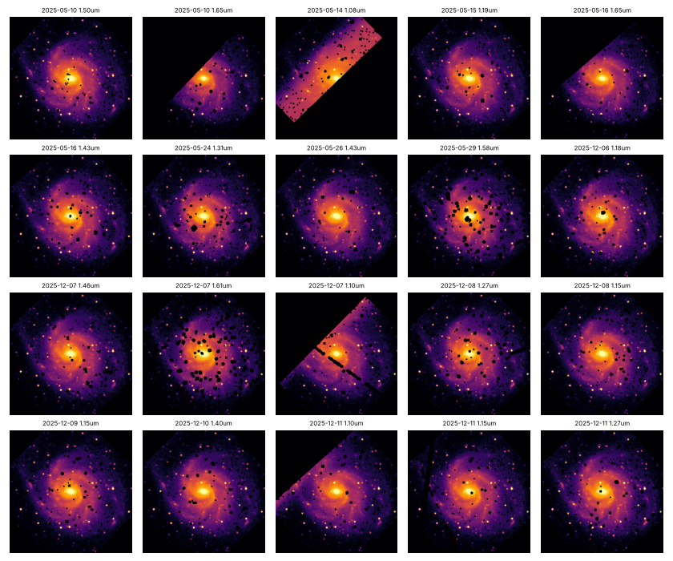

# NASA Space Apps Challenge – SPHEREx

A public web tool for viewing SPHEREx images of the sky and how they change over time.

## Getting the data

SPHEREx images live in the NASA/IPAC Infrared Science Archive (IRSA) and can be searched
with its [Simple Image Access v2 (SIA) service](https://irsa.ipac.caltech.edu/ibe/sia.html).

| Collection          | What it is                                               |
|---------------------|----------------------------------------------------------|
| `spherex_dr1`       | Data Release 1 – calibrated single exposures (Level 2)   |
| `spherex_dr1_deep`  | DR1 deep-field products                                  |
| `spherex_dr1_cube`  | DR1 spectral cubes                                       |
| `spherex_qr3`       | Quick Release 3 – earlier quick-look exposures           |

### 1. Ask which images cover a position

```bash
curl -o results.vot "https://irsa.ipac.caltech.edu/SIA?COLLECTION=spherex_dr1&POS=circle+210.80225+54.34894+0.001"
```

Each row is one image. Useful columns: `access_url` (the file), `t_min` (time, MJD),
`energy_bandpassname` (detector `SPHEREx-D1`…`D6`), `em_min`/`em_max` (wavelength, m).

### 2. Download – use cutouts, not full images

A full SPHEREx image is about 65 MB (2040×2040 px, 3.5° wide). IRSA can cut out just the
region you need if you add `?center=RA,DEC&size=DEG` to the `access_url`:

```bash
curl -o cutout.fits "https://irsa.ipac.caltech.edu/ibe/data/spherex/dr1/level2/2025W19_2B/l2b-v27-2026-198/3/level2_2025W19_2B_0101_1D3_spx_l2b-v27-2026-198.fits?center=210.80225,54.34894&size=0.3"
```

### 3. Or run the script

```bash
pip install -r requirements.txt
```

```bash
python scripts/download_sample.py
```

```bash
python scripts/download_sample.py --ra 83.82 --dec -5.39 --name orion --bands D1 D4
```

This queries SIA, picks one exposure per visit, downloads 0.3° cutouts (~570 KB each, with
the 4 MB PSF table removed; use `--keep-psf` to keep it), and writes PNG previews, all
reprojected onto the same north-up grid so they line up frame to frame.

## Sample dataset: `data/sample/m101/`

The Pinwheel Galaxy (M101), 20 SPHEREx DR1 exposures from detector D2 (~1.1–1.65 µm),
covering both survey passes: **May 2025** and **December 2025**. Total size is about 12 MB.

```
data/sample/m101/
├── manifest.json     # one entry per frame: date, band, wavelength, file paths
├── sia_results.csv   # every one of the 246 DR1 images that cover M101 (metadata only)
├── fits/             # science cutouts: IMAGE, FLAGS, VARIANCE, ZODI, WCS-WAVE
├── png/              # 256×256 previews, north up, aligned for blinking/animation
└── overview.png      # contact sheet of all frames
```



### Things to know about SPHEREx images

- **Wavelength varies across each image.** SPHEREx uses a linear variable filter, so the
  same object is seen at a different wavelength in each exposure. `manifest.json` gives the
  wavelength at the target (`wavelength_um`), which is useful for picking frames that compare fairly.
- **Six detectors:** D1–D3 cover 0.75–2.4 µm and D4–D6 cover 2.4–5 µm.
- **FLAGS:** bit 21 (`SOURCE`) only marks pixels with a detected source. The other bits
  mark bad pixels (cosmic rays, saturation, …). The previews mask those as black.
- Each image has its own rotation, which is why the previews are reprojected to a common grid.
